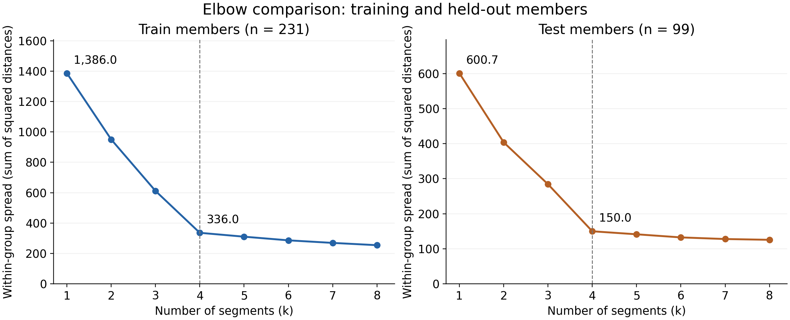
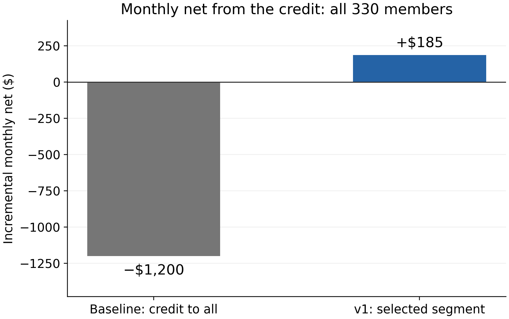

# Gym member clustering: technical analysis

## Data and model

Source: the course-provided `gym_members.csv`. 330 members, seven columns,
with usage/spending averages over the previous three months. Exact calendar dates
are not supplied. Mean monthly extras spend: $26.01.
There are no missing feature values or duplicate member IDs.

Random 70/30 split with seed 42: 231 training members and 99 test members.
Use all six numeric features except `member_id`, which identifies a row rather than
describing a member. Age describes demographics, months_member describes tenure,
and the remaining features describe usage and spending. StandardScaler uses only
training means and population standard deviations. K-means uses Euclidean distances,
k-means++ initialization, 50 initializations, Lloyd's algorithm, and seed 42.
All candidate models share the same features, split, scaling, and settings; only k changes.

## Fit comparison

Choose k = 4 from the training elbow. The training spread falls substantially
through k = 4, then decreases much more slowly. The held-out curve has the same bend.
Test members are assigned to training centers; neither scaling nor centers are refitted.
The model is also not refitted when assigning all 330 members.

| k | train_sse | test_sse | train_sse_per_member | test_sse_per_member | train_reduction_from_previous_pct | test_reduction_from_previous_pct |
| --- | --- | --- | --- | --- | --- | --- |
| 1 | 1386.00 | 600.73 | 6.00 | 6.07 | — | — |
| 2 | 950.26 | 403.62 | 4.11 | 4.08 | 31.44 | 32.81 |
| 3 | 611.54 | 284.19 | 2.65 | 2.87 | 35.65 | 29.59 |
| 4 | 335.99 | 149.98 | 1.45 | 1.51 | 45.06 | 47.22 |
| 5 | 310.47 | 141.39 | 1.34 | 1.43 | 7.60 | 5.73 |
| 6 | 286.45 | 132.53 | 1.24 | 1.34 | 7.74 | 6.27 |
| 7 | 269.59 | 127.89 | 1.17 | 1.29 | 5.89 | 3.50 |
| 8 | 254.55 | 125.66 | 1.10 | 1.27 | 5.58 | 1.75 |

Test spread: 600.730 at k = 1 versus 149.984 at
k = 4, a 75.03% reduction. These are squared distances in standardized
feature space, not dollars or a classification accuracy. Raw training/test sums differ
partly because sample sizes differ; per-member values are included for comparison.

## Training centroids in original units

Names describe relative behavior in this dataset, not verified motivations.
Full-population counts below are distinct from the training-only centroids here.

| Training centroid feature | New occasional visitors | Class-focused spenders | Long-tenure regulars | Frequent independent users |
| --- | --- | --- | --- | --- |
| age | 27.33 | 42.59 | 64.16 | 33.15 |
| visits_per_month | 3.04 | 9.44 | 11.96 | 16.04 |
| avg_visit_minutes | 40.70 | 55.13 | 46.53 | 64.46 |
| classes_per_month | 0.89 | 6.95 | 3.87 | 0.87 |
| months_member | 5.76 | 23.97 | 57.82 | 30.27 |
| monthly_extras_spend | 8.98 | 47.33 | 17.36 | 24.89 |

- New occasional visitors: low visit frequency, short tenure, and low extras spending.
- Class-focused spenders: frequent classes and the highest extras spending.
- Long-tenure regulars: older members with long tenure and moderate extras spending.
- Frequent independent users: many long visits and few group classes.

## Segment credit policy

Finance assigns +$5 net to a recipient spending below $20 and -$10 to a recipient
spending at least $20. No credit means $0 incremental net. For each segment, sum
these member-level values on the training members and offer the credit only if the
sum is positive. Equivalently, more than two thirds must be below $20. A tie gets no
credit. The policy is fixed before applying it to test members or the full population.
Do not decide from centroid spending: a mean below $20 does not imply positive net.

| segment | train_count | test_count | all_count | train_below_20 | train_below_20_share | train_net_if_credit | all_below_20 | all_at_least_20 | all_mean_extras | gets_credit | all_baseline_net | all_v1_net |
| --- | --- | --- | --- | --- | --- | --- | --- | --- | --- | --- | --- | --- |
| New occasional visitors | 46 | 24 | 70 | 38 | 0.83 | 110 | 59 | 11 | 9.30 | True | 185 | 185 |
| Class-focused spenders | 61 | 30 | 91 | 1 | 0.02 | -595 | 1 | 90 | 46.93 | False | -895 | 0 |
| Long-tenure regulars | 45 | 15 | 60 | 27 | 0.60 | -45 | 37 | 23 | 16.35 | False | -45 | 0 |
| Frequent independent users | 79 | 30 | 109 | 31 | 0.39 | -325 | 43 | 66 | 24.60 | False | -445 | 0 |

## New member

Input: {"age": 30, "visits_per_month": 4, "avg_visit_minutes": 42, "classes_per_month": 1, "months_member": 5, "monthly_extras_spend": 10}.
The fitted `GymSegments.offer_for_member(member)` function returns
`{"segment": "New occasional visitors", "gets_credit": true}`. It uses the existing scaler, nearest training center,
and fixed segment policy. This first-month use assumes the supplied measurements
are comparable to the three-month averages used in training; the data do not test
that temporal assumption.

## Monthly value

The baseline sends the credit to everyone. It is a single targeting group, but its
economics must still be calculated member by member, not from the overall $26.01 mean.
These values are incremental margin from the credit relative to no credit, not total
gym revenue/profit. Under the supplied assumptions:

| population | members | baseline_recipients | v1_recipients | baseline_credit_cost | v1_credit_cost | baseline_incremental_margin | v1_incremental_margin | baseline_net | v1_net | improvement |
| --- | --- | --- | --- | --- | --- | --- | --- | --- | --- | --- |
| all | 330 | 330 | 70 | 3300 | 700 | 2100 | 885 | -1200 | 185 | 1385 |
| train | 231 | 231 | 46 | 2310 | 460 | 1455 | 570 | -855 | 110 | 965 |
| test | 99 | 99 | 24 | 990 | 240 | 645 | 315 | -345 | 75 | 420 |

For all members, baseline = $2,100 added margin
minus $3,300 credits = $-1,200/month.
v1 = $885 added margin minus
$700 credits = $185/month.
Difference = $1,385/month. The full-population calculation includes
both training and test members as requested; it is not an entirely held-out estimate.
The separate test row evaluates the fixed policy on held-out members.
Finance's response assumptions are stipulated, not estimated or causally validated here.

## Reproducibility

Run `python analysis.py` from an environment with `requirements.txt` installed.
The script writes all tables, figures, this report, and `results.json`; no slide
values need to be typed into the analysis. Source SHA-256: `2503d59b1ddfa38502aeee2b87c81e931ab06bc7edd77bebc3577bc9544c84ad`.
Installed versions are recorded in `results.json`.

This is a technical analysis, not submission slides. The assignment requires the
student to write the slides: one title slide plus two content slides, exported to
one PDF. The title slide needs the student's name and the repository link.
